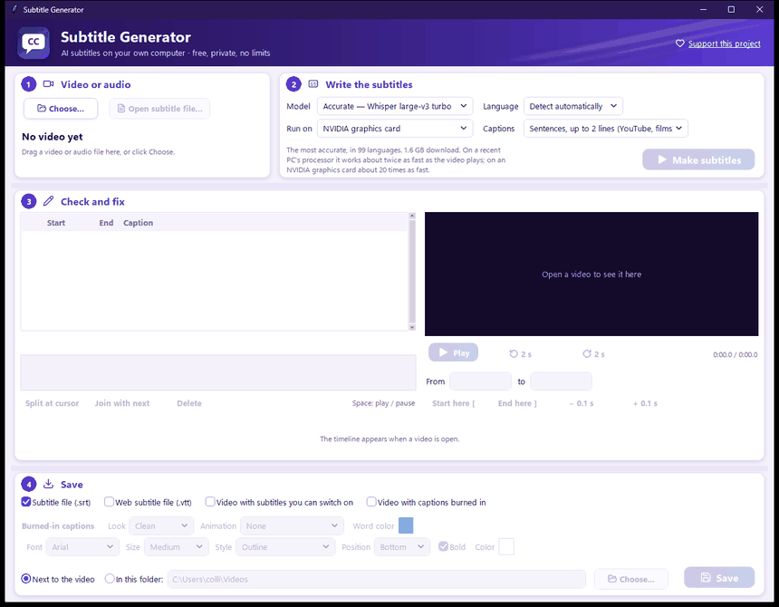

# Subtitle Generator

**Free, offline alternative to paid auto-subtitle sites. No per-minute fees, no watermark, no uploads.**



Listens to a video (or audio file) and writes its subtitles with **OpenAI's Whisper** speech
recognition, running on your own computer, in 99 languages. Watch it back in the built-in player
with the captions drawn live, fix anything on a timeline, give them an animated look, then save:

- a **subtitle file** (`.srt`, for YouTube, VLC, Premiere and most players, or `.vtt` for the web)
- a **video with subtitles you can switch on**: added as a track, with no re-encoding, so it's
  quick and loses no quality
- a **video with the captions burned in**, for TikTok, Reels and Shorts: plain, or **animated word
  by word** (karaoke highlight, words popping in, or one big word at a time), from one-click looks
  or your own font, size, colors, style and position

Your video never leaves your computer. Works on Windows and macOS, and on Windows PCs with an
NVIDIA graphics card it runs on the card, about 20 times as fast as the video plays.

## Download
Get the latest version from the [Releases page](https://github.com/collinb0607/subtitle-generator/releases/latest).

| Your computer | Download | First launch |
|---|---|---|
| Windows 10/11 | `Subtitle-Generator-Windows.exe` | Windows may show "Windows protected your PC" because the app isn't signed. Click **More info**, then **Run anyway**. The first start takes a few seconds. |
| Mac with Apple Silicon (M1 or newer) | `Subtitle-Generator-macOS.zip` | Unzip, then open **Subtitle Generator**. macOS blocks it the first time because the app isn't notarized: open **System Settings → Privacy & Security**, scroll down and click **Open Anyway**. |

On an Intel Mac, or any other system, run it from source with Python (below).

**The speech model downloads once.** The first time you use a model, the app asks to download it
(485 MB or 1.6 GB, from Hugging Face), and checks every file against its published checksum. After
that everything works offline. Models are kept in `~/.subtitle-generator/models`
(`C:\Users\<you>\.subtitle-generator\models` on Windows).

## Choosing a model
Measured on a 39-second clip, on a PC with a 16-thread processor and an NVIDIA RTX 3060 Ti.

| Model | Download | On the processor | On an NVIDIA card | Best for |
|---|---|---|---|---|
| **Accurate — Whisper large-v3 turbo** | 1.6 GB | about 2× as fast as the video plays | about 20× | Accents, background noise, rare words and names, and languages other than English. The default with an NVIDIA card. |
| **Fast — Whisper small** | 485 MB | about 5× | about 20× | Clear speech, on a computer without an NVIDIA card. Makes more mistakes. |

**NVIDIA graphics cards (Windows):** choose **Run on: NVIDIA graphics card**. The first time, it
asks to download NVIDIA's cuBLAS library (553 MB, from NVIDIA's official package; about 770 MB once
unpacked, in `~/.subtitle-generator/cuda`). If the card can't be used (an old driver, say), the app
says so and uses the processor instead. Macs and other graphics cards use the processor.

## How it works
1. **Open a video or audio file**: drag it onto the window, or click **Choose**. MP4, MOV, MKV,
   WebM, AVI and more; MP3, WAV, M4A, FLAC and other audio files make subtitle files only.
2. **Make subtitles.** Pick the language, or let Whisper detect it. **Captions** sets their length:
   **Sentences, up to 2 lines** (YouTube, films), or **Short phrases, 1 line** (Shorts, Reels,
   TikTok). Captions follow the speech: they break at the ends of sentences and at pauses, and stay
   on screen long enough to read. They appear in the list as they're written.
3. **Check and fix** in the player: the video plays with its sound and the captions drawn exactly
   as they'll be burned in, animations and all, and the caption being spoken lights up in the list.
   - **Space** plays and pauses; the arrow keys skip 2 seconds; double-click a caption to play just
     that one.
   - The **timeline** shows every caption as a block: click one to pick it, click or drag anywhere
     else to jump there.
   - Type to fix words. Change a caption's times by typing them, or while watching: **Start here**
     (`[`) and **End here** (`]`) set them to the player's position, and **− 0.1 s** / **+ 0.1 s**
     move the caption. **Split at cursor**, **Join with next** and **Delete** do what they say.
   - Every caption keeps the time of each word, so the animations stay in step: edit the text and
     the words you didn't change keep their exact times.
4. **Save** any of the four outputs, next to the video or in a folder you choose: `talk.mp4` gives
   `talk.srt`, `talk.vtt`, `talk (subtitles).mp4` and `talk (captions).mp4`. Naming the subtitle
   file like the video means players such as VLC show it automatically.

Already have subtitles? **Open subtitle file** loads an `.srt` or `.vtt`, to fix it, add it to
the video as a track, or burn it in.

**Burned-in captions:**
- **Looks** set everything at once: **Clean** (white with an outline), **Karaoke** (each word lights
  up as it's spoken), **Bold pop** (big words that pop in one by one), **One word** (a single big
  word at a time, for fast-paced Shorts) and **Boxed** (white on a dark box). Change anything after
  and it becomes **Custom**.
- **Animation:** none, highlight each word, words pop in, or one word at a time, with your choice of
  **word color**.
- Arial, Verdana, Trebuchet MS, Georgia or Impact; four sizes (scaled to the video, so vertical
  videos look right too); bold; any color; an **outline**, a **box behind the text**, or a
  **shadow**; at the bottom, middle or top.

Animations are for the burned-in video: `.srt`, `.vtt` and subtitle tracks can't animate, so they
show the plain text. The burned-in video is H.264 MP4 at high quality; the sound is copied as it is
when it can be.

## Run from source (Python)
### Setup (one time)
1. Install **Python 3.9+** from https://python.org. On Windows, tick **"Add Python to PATH"** during install.
2. Run the app (see below). The first time, it asks to install **faster-whisper** (Whisper, with
   CTranslate2), **imageio-ffmpeg** (FFmpeg, which reads the sound and makes the videos), **Pillow**
   (the player's picture), **certifi** (for the model download), **sounddevice** (the player's
   sound) and **tkinterdnd2** (drag and drop). Click **Yes**; it's about a 150 MB download.

### Run
```
python subtitle_generator.py        # Windows
python3 subtitle_generator.py       # macOS
```
On Windows you can also double-click `subtitle_generator.py`. If you have more than one Python
installed, double-clicking can run a different one from `python` in a terminal, so it may ask to
install the components once more. The install dialog shows which Python it installs into.

## Troubleshooting
- **Some words are wrong:** try the **Accurate** model, and pick the language instead of
  **Detect automatically**. Names and jargon are the hardest; fix them in the list before saving.
- **"The graphics card couldn't be used":** update the NVIDIA driver (from nvidia.com or the
  GeForce/NVIDIA app) and try again. Until then the processor is used.
- **"No speech was found":** the sound may be music only, very quiet, or silent.
- **"Not enough memory":** use the **Fast** model, or close other programs.
- **The model download fails:** check your internet connection and try again. A failed or
  canceled download is never used.
- **Something fails with no message:** errors are also written to `subtitle_generator_errors.log`
  in your temp folder. On Windows, paste `%TEMP%\subtitle_generator_errors.log` into File Explorer's
  address bar. On Mac, run `open $TMPDIR/subtitle_generator_errors.log`.

## Credits
Speech recognition is [Whisper](https://github.com/openai/whisper) by OpenAI (MIT), run with
[faster-whisper](https://github.com/SYSTRAN/faster-whisper) and
[CTranslate2](https://github.com/OpenNMT/CTranslate2) (MIT). The converted models are
[Systran/faster-whisper-small](https://huggingface.co/Systran/faster-whisper-small) and
[dropbox-dash/faster-whisper-large-v3-turbo](https://huggingface.co/dropbox-dash/faster-whisper-large-v3-turbo)
(MIT). Videos are made with [FFmpeg](https://ffmpeg.org) (via imageio-ffmpeg) and
[libass](https://github.com/libass/libass), and the player's sound is played with
[sounddevice](https://github.com/spatialaudio/python-sounddevice) and PortAudio (MIT). NVIDIA's
cuBLAS is downloaded from NVIDIA's own package,
under NVIDIA's license, only if you choose the graphics card.

The icons are from [Lucide](https://lucide.dev) (ISC license, see [assets/LUCIDE-LICENSE.txt](assets/LUCIDE-LICENSE.txt)).

## Support this project
This app is free, with no ads, accounts or limits. If it saved you time or a subscription, you can
support its development on Ko-fi:

[](https://ko-fi.com/collinbrooksdev)

## Part of the Offline Toolkit
Also by me: [GIF Maker](https://github.com/collinb0607/gif-maker),
[Video Compressor](https://github.com/collinb0607/video-compressor),
[Audio Converter](https://github.com/collinb0607/audio-converter),
[Image Converter](https://github.com/collinb0607/image-converter),
[Background Remover](https://github.com/collinb0607/background-remover),
[Image Upscaler](https://github.com/collinb0607/image-upscaler) and
[PDF Toolkit](https://github.com/collinb0607/pdf-toolkit): free, offline replacements for websites
that cap your file size, add a watermark, or want a subscription.
